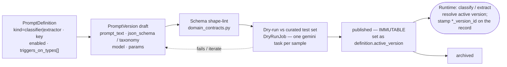

# CDEW — Workflow

How a document moves through CDEW, as built. Stage semantics come from
[`design.md`](./design.md) §3; the branch logic mirrors
`apps/pipeline/service.py`, `classify.py`, `extract.py`.

`FHIR → documents → CDEW → promop`

## Pipeline

```mermaid
flowchart TD
    UP["Upload — manual or FHIR-derived<br/>PDF · image · DOCX · XLSX · MD/txt"]
    ING["<b>Ingest &amp; normalize</b><br/>sniff mime · sha256 dedup per patient<br/>immutable original → object storage"]
    JOB["ExtractionJob created<br/>status=queued · stage=ingest"]
    DISP{"PREFECT_DISPATCH"}
    LOCAL["local — inline in API process"]
    THREAD["thread — background thread,<br/>ephemeral Prefect API"]
    DEPLOY["deployment — run_deployment<br/>on Prefect worker"]
    EXEC["execute_pipeline job_id, runner<br/>single source of job-state transitions"]

    PARSE["<b>Parse</b> — markitdown → DocumentText<br/>markdown + char offsets, versioned by parser"]
    POK{"parse ok?"}
    PFAIL["job failed · code=parse_failed<br/>doc.status=parse_failed"]
    EMPTY{"near-empty text?<br/>scanned / image, no text layer"}

    AUTO{"PIPELINE_AUTO_CLASSIFY?"}
    QUEUE["<b>Human classification queue</b><br/>doc.status=needs_classification<br/>job completes here by default"]
    RECLS["Reviewer classifies →<br/>re-triggers classify → extract"]

    CLS["<b>Classify</b> — LLM, multi-label<br/>active classifier PromptVersion<br/>each taxonomy type scored independently"]
    THRESH{"any type ≥ its threshold?"}
    UNCL["unclassified<br/>reason = ambiguous  (best ≥ low_floor)<br/>vs out_of_taxonomy  (below floor)"]
    ROUTED["DocumentClassification<br/>outcome=routed · routed_types[]<br/>doc.status=classified"]

    EXT["<b>Extract</b> — union of enabled extractors<br/>whose triggers match routed_types<br/>each loads its active version · runs concurrently<br/>multimodal: original PDF/image fed alongside text"]
    SPAN{"span resolvable?<br/>verbatim snippet is authoritative"}
    FLAG["fact flagged — no resolvable span<br/>never staged-as-clean"]
    STAGE["<b>Stage</b> — ExtractionRecord status=staged<br/>payload + provenance snippet/char range<br/>+ immutable extractor_version_id"]

    REVIEW["<b>Review UI</b> — click-a-fact → highlight source<br/>verify · correct · add missing facts · categorize doc"]
    APPROVED["approved — v1 terminal state"]
    REJECTED["rejected"]
    PROMOP["<i>later phase</i> — commit as FHIR R4 bundle<br/>source values only → promop /api/v1/fhir/sync/<br/>promop codes (LOINC/SNOMED/RxNorm) + dedups"]

    UP --> ING --> JOB --> DISP
    DISP --> LOCAL --> EXEC
    DISP --> THREAD --> EXEC
    DISP --> DEPLOY --> EXEC
    EXEC --> PARSE --> POK
    POK -- no --> PFAIL
    POK -- yes --> EMPTY
    EMPTY -- yes --> QUEUE
    EMPTY -- no --> AUTO
    AUTO -- "off (default)" --> QUEUE
    AUTO -- on --> CLS
    QUEUE --> RECLS --> CLS
    CLS --> THRESH
    THRESH -- no --> UNCL --> QUEUE
    THRESH -- yes --> ROUTED --> EXT --> SPAN
    SPAN -- no --> FLAG --> REVIEW
    SPAN -- yes --> STAGE --> REVIEW
    REVIEW --> APPROVED
    REVIEW --> REJECTED
    APPROVED -.-> PROMOP

    classDef llm fill:#ede9fe,stroke:#7c3aed,color:#1e1b4b
    classDef human fill:#fef3c7,stroke:#d97706,color:#451a03
    classDef bad fill:#fee2e2,stroke:#dc2626,color:#450a0a
    classDef later fill:#f1f5f9,stroke:#94a3b8,color:#0f172a,stroke-dasharray: 4 3
    class CLS,EXT llm
    class QUEUE,RECLS,REVIEW,APPROVED,REJECTED human
    class PFAIL,UNCL,FLAG bad
    class PROMOP later
```

Purple = LLM step (gemini via Pydantic AI) · amber = human step · red = failure or
human-triage branch · dashed = not built in v1.

## Prompt & schema management

Both LLM steps resolve their prompt at runtime from the DB, so behaviour changes by
publishing a version — never by editing code.

Every `DocumentClassification` and `ExtractionRecord` stores the version id that
produced it, so history stays reproducible after a newer version is published.

> **Planned change** ([`promop-alignment.md`](./promop-alignment.md)): extractor
> authoring moves from a hand-written `json_schema` per `domain` to selecting
> **object types** from a promop-synced catalog; prompts are then *composed* from
> the catalog (per-object sections + authored guidance) and extraction emits a
> tagged union `{object_type, data, provenance}`. The lifecycle above (draft →
> lint → dry-run → publish → immutable) is unchanged.

## Job state

`ExtractionJob` is the UI's source of truth for progress; `stage_history` records
stage-entry timestamps (PHI-safe — stage names + times only).

| stage | progress | status |
|-------|----------|--------|
| `ingest` | 0.0 | `queued` |
| `parse` | 0.1 | `running` |
| `classify` | 0.6 | `running` |
| `extract` | 0.85 | `running` |
| `done` | 1.0 | `completed` / `failed` / `cancelled` |

On failure the last `stage_history` entry stays the stage that stopped, so the UI can
show where; `errors[]` carries safe codes only (`parse_failed`, `classify_error`,
`extract_error`, `pipeline_error`) — never PHI.
